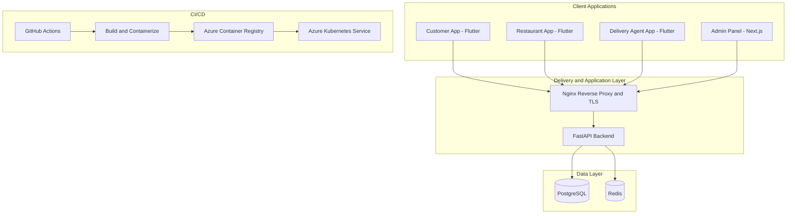

  
   
  <h1>Hi, I'm Sajid Khan 👋</h1>
  <h3>DevSecOps Engineer · Cloud Automation · Full-Stack Deployment</h3>
  
<b>Building, securing, and deploying real-world applications.</b>

  
I turn infrastructure into code, automate delivery pipelines, and help applications move from development to production.

  

    
    
    
  

  

---

## 👨‍💻 About Me

I'm a DevSecOps Engineer based in Lucknow, India, focused on Microsoft Azure, Infrastructure as Code, containers, and CI/CD automation. I enjoy making deployments repeatable, improving server reliability, and connecting application development with secure cloud operations.

My hands-on work spans Terraform-managed infrastructure, Docker-based deployments, Kubernetes, Linux server administration, release operations, database migrations, and troubleshooting production applications.

- ☁️ **Cloud:** Microsoft Azure, Azure CLI, AKS, ACR, VNets, NSGs, Storage
- 🏗️ **Infrastructure as Code:** Terraform, reusable modules, remote state
- 🔁 **CI/CD:** GitHub Actions, Azure DevOps YAML pipelines
- 📦 **Containers:** Docker, Docker Compose, Kubernetes
- 🔐 **Security & Operations:** SSH hardening, RBAC, secrets handling, Nginx, SSL/TLS
- 📍 **Location:** Lucknow, Uttar Pradesh, India

## 🏢 VEXOR — Digital Solutions & Cloud Engineering

  
  
<b>Modern technology. Thoughtful engineering. Reliable delivery.</b>

VEXOR is my agency brand for helping businesses build digital products and get them deployed reliably. The focus is on practical solutions that connect product development, cloud infrastructure, and ongoing delivery.

| Service | What it covers | Example technologies |
|---|---|---|
| **Web & Full-Stack Development** | Responsive business websites, web applications, dashboards, and API integration | React, Next.js, FastAPI |
| **Cloud Infrastructure** | Cloud resource setup, repeatable environments, and infrastructure automation | Microsoft Azure, Terraform, Azure CLI |
| **DevOps & CI/CD** | Automated build, validation, image publishing, and deployment workflows | GitHub Actions, Azure DevOps, YAML |
| **Containerization** | Packaging applications and running container-based workloads | Docker, Docker Compose, Kubernetes, AKS, ACR |
| **Server Setup & Deployment** | Linux server configuration, reverse proxy, HTTPS, and release support | Ubuntu, Nginx, SSH, SSL/TLS |

> Have a project or deployment challenge? [Contact me by email](mailto:sajidkhan299720@gmail.com). Add VEXOR's official website and social links here once they are public.

---

## 🚀 Featured Project: HungryKart — Food Delivery Platform

**My role: End-to-end deployment, cloud infrastructure, and server-side operations**

HungryKart is a food delivery platform with a FastAPI backend, a Next.js admin panel, and three Flutter apps for customers, restaurant partners, and delivery agents. My work includes deployment and release operations across application and infrastructure layers.

### Architecture at a glance

### Work and responsibilities

- Containerized application components using Docker and Docker Compose on Ubuntu.
- Managed application releases, rebuilds, Alembic database migrations, and health checks.
- Worked with Terraform-provisioned Azure resources, including AKS and Azure Container Registry.
- Set up GitHub Actions workflows to build and publish container images and support deployments.
- Configured Nginx reverse proxy and SSL/TLS, SSH key-based access, a restricted service user, and limited sudo access.
- Worked on admin capabilities including menu management, pricing and GST settings, and delivery-agent incentives.
- Prepared signed Android release builds for Google Play publishing.

**Stack:** FastAPI · Next.js · Flutter · Docker · Docker Compose · Azure · AKS · ACR · Terraform · GitHub Actions · Nginx · PostgreSQL · Redis · Alembic

## 🧩 Other Projects

### ☁️ Azure Multi-Environment Web App Deployment

- Created separate development and production environments using Terraform modules and variables.
- Worked with Azure infrastructure, Docker, ACR, AKS, Nginx, and GitHub Actions.
- Focused on repeatable provisioning and automated application delivery.

### 🏛️ Azure Landing Zone

- Built a foundational Azure environment using Terraform and Azure CLI.
- Worked with resource groups, hub-and-spoke virtual networks, NSGs, role assignments, and Azure Policy.

### 🛡️ Terraform Security Scanning Practice

- Hands-on practice with Trivy, Checkov, and TFLint for infrastructure code and configuration checks.
- Working toward integrating scanning and validation into CI/CD workflows.

> Replace the project titles above with links to the corresponding public repositories when those repository URLs are confirmed.

## 🧰 Tech Stack

  

| Area | Tools and technologies |
|---|---|
| **Cloud** | Microsoft Azure, VMs, VNets, NSGs, Storage, AKS, ACR, Load Balancer, Application Gateway, Azure CLI |
| **Infrastructure as Code** | Terraform, modules, variables, remote state, workspaces |
| **CI/CD** | GitHub Actions, Azure DevOps, YAML pipelines, Git workflows, pull requests |
| **Containers** | Docker, Docker Compose, Kubernetes, Azure Kubernetes Service |
| **Systems & Networking** | Ubuntu Linux, Bash, PowerShell, Nginx, SSH, SSL/TLS |
| **Security tools** | Trivy, Checkov, TFLint, RBAC, secrets management, least privilege |
| **Application & data** | FastAPI, Next.js, Flutter, PostgreSQL, Redis, Alembic |

## 💼 Experience

**DevOps Engineer Intern — DevOps Insiders**  
*February 2026 – Present*

- Work with Azure resources using Azure Portal, Azure CLI, and Terraform.
- Set up Azure DevOps repositories, boards, and multi-stage YAML pipelines.
- Containerize applications with Docker and work with Azure Container Registry and AKS deployments.
- Build reusable Terraform modules and use Azure Storage for remote state.
- Follow Git branching and pull-request workflows.

## 🎓 Education

**Bachelor of Computer Applications (BCA)**  
Integral University, Lucknow, Uttar Pradesh, India

## 📊 GitHub Activity

  
  

## 🤝 Let's Connect

I'm interested in DevSecOps and cloud engineering opportunities, collaboration on real-world projects, and helping businesses improve how they build and deploy software.

- **GitHub:** [@sajidkhan-DevOps](https://github.com/sajidkhan-DevOps)
- **Email:** [sajidkhan299720@gmail.com](mailto:sajidkhan299720@gmail.com)
- **Agency:** VEXOR — add official website and social links when available

  Designed with care by Sajid Khan · Cloud, automation, and delivery with VEXOR

